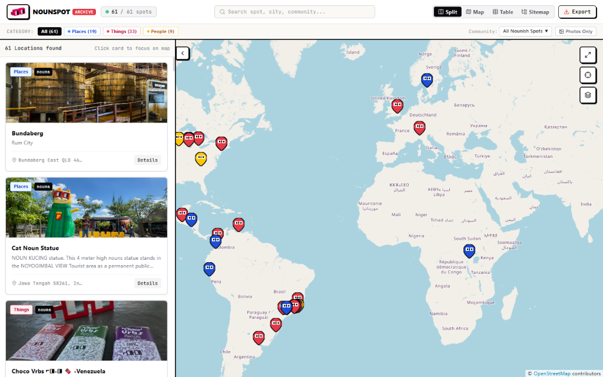

# Nounspot Archive

This is xpp way of preserving Nounspot.



A standalone, zero-dependency preservation repository and interactive open-source atlas of authentic Nounish locations, installations, artworks, and community landmarks around the world.

## Overview

The original nounspot.com service became non-functional due to external dependency failures:
1. The Google Maps JavaScript API key reached its quota and billing restrictions, breaking the interactive map client-side.
2. The sitemap endpoint (sitemap.xml) was missing (HTTP 404), preventing search engines and archives from discovering location records.
3. Third-party database reliance left the historical record of global community spots vulnerable to permanent loss.
4. Bulk-imported non-Noun entries (such as Cursor workshop placeholders) diluted the authenticity of the directory.

This archive cleans, verifies, and permanently preserves the genuine Nouns ecosystem records in open data formats and packages them into a high-performance, space-maximizing web interface.

## Preservation Scope

- Verified Spots: 61 authentic Nouns DAO and Gnars community locations
- Curated Data: All 69 third-party Cursor workshop placeholder entries were identified and purged
- Geographic Verification: 100% of preserved locations contain verified latitude and longitude coordinates
- Media Preservation: High-resolution photos are downloaded and stored locally in preserved_data/photos/
- Categories Preserved: Things (33), Places (19), People (9)
- Communities Covered: Nouns DAO and Gnars Sub-DAO across 20+ countries

## Preserved Formats

All datasets are stored in open standard formats under preserved_data/ and public/:

- preserved_data/spots.json: Complete JSON record including IDs, names, descriptions, addresses, coordinates, creation timestamps, contributor wallets, and photo mappings.
- preserved_data/spots.geojson: Standard GIS FeatureCollection ready for QGIS, Mapbox, Felt, Keplr, or ArcGIS.
- preserved_data/spots.csv: Flat tabular format suitable for Excel, Google Sheets, Python, and data science workflows.
- preserved_data/sitemap.xml: Standard XML sitemap containing canonical URLs for every preserved location.
- preserved_data/photos/: Full-resolution local copies of all community-submitted photos.
- public/noggles.png: Official logo asset.
- preview.png: Full application preview screenshot.

## Web Application Architecture

The accompanying client application is built to maximize screen space and operate without proprietary external dependencies:

- Map Engine: 100% open-source Leaflet integration with OpenStreetMap (OSM) Standard tiles by default.
- Layer Switcher: Allows toggling between OpenStreetMap Standard, OSM Humanitarian (HOT), and OpenTopoMap without API keys.
- Typography: Authentic Nouns DAO display typography powered by Google Fonts Londrina Solid, paired with JetBrains Mono for coordinates.
- Layout: Edge-to-edge space maximization featuring:
  - Split View: Collapsible side drawer with spot cards alongside the interactive map.
  - Map View: Fullscreen uninterrupted map exploration.
  - Table View: High-density spreadsheet grid with sortable columns and one-click coordinate copy.
  - Sitemap Directory: Hierarchical directory grouped by Country, Community, or Category with direct export downloads.
- Full Image Modal: High-resolution lightbox viewer when clicking photos within spot details.

## Getting Started

### Prerequisites

- Node.js (version 18 or newer recommended)
- pnpm (package manager)

### Installation

Clone the repository and install dependencies using pnpm:

```bash
git clone https://github.com/XppaiCyberr/nounspot-archive.git
cd nounspot-archive
pnpm install
```

### Development Server

Start the local development server:

```bash
pnpm run dev
```

Open http://localhost:3000 in your browser.

### Production Build

Compile the standalone production build:

```bash
pnpm run build
```

The optimized output will be generated in the dist/ folder, ready for deployment to GitHub Pages, Vercel, Netlify, or any static web server.

### Preview Production Build

Preview the production bundle locally:

```bash
pnpm run preview
```

## Data Schema

Each spot record in spots.json conforms to the following structure:

```json
{
  "id": "14eb5784-cf5b-4b6f-8529-a6750ffca558",
  "name": "Bundaberg",
  "description": "Rum City",
  "category": "Places",
  "address": "Hills St, Bundaberg East QLD 4670, Australia",
  "locationLat": -24.85334797026732,
  "locationLng": 152.3667612397633,
  "community": ["nouns"],
  "photoUrl": "https://ldmpyktgqncwrkqnmcww.supabase.co/storage/v1/object/public/nounspot-uploads/spots/1792112752708-1000297638.jpg",
  "localPhotoPath": "photos/14eb5784-cf5b-4b6f-8529-a6750ffca558.jpg",
  "contactLink": null,
  "ownerEmail": "Datwhyunohab@gmail.com",
  "createdAt": "2026-10-16T01:05:53.654Z",
  "updatedAt": "2026-10-16T01:05:53.654Z"
}
```

## License

This project preserves CC0 public domain and open-source assets created by the global Nouns DAO community.
The mapping data is provided by OpenStreetMap contributors under the Open Database License (ODbL).
The application code is released under the MIT License.
